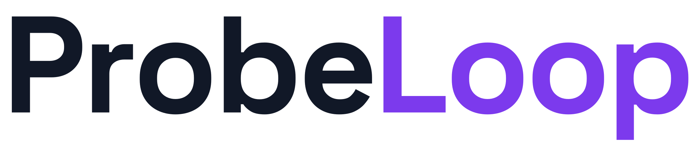

  
  
  
  
  
  
  
  

  <picture>
    <source media="(prefers-color-scheme: dark)" srcset="docs/assets/wordmark-dark.svg" />
    <source media="(prefers-color-scheme: light)" srcset="docs/assets/wordmark-light.svg" />
    
  </picture>

Self-hosted interview practice with adaptive follow-ups and reviewable feedback.

  <a href="#getting-started">Get started</a> ·
  <a href="docs/README.md">Documentation</a> ·
  <a href="docs/architecture.md">Architecture</a> ·
  <a href="docs/roadmap.md">Roadmap</a> ·
  <a href="CONTRIBUTING.md">Contribute</a>

> **Early development.** The preparation, interview and reporting workflows are implemented.
> Interview quality across professions, recognition accuracy on real speech and physical Mac
> performance remain acceptance gates. Pilot results are development evidence, not a guarantee
> of assessment accuracy. See [current status](docs/status.md).

## What you can do

- **Prepare a relevant interview.** Supply a CV, a job offer or titled resources, review the
  extracted facts, and confirm the profession, target role and seniority.
- **Practise in text or voice.** Follow-up questions respond to your answers and approved context.
  Voice interviews use explicit turn-taking: answer, then indicate that you are finished.
- **Choose your processing tools.** Configure the interviewer, document analysis, evaluation and
  stated-limit reader independently in Settings. Use ChatGPT, local Ollama models, or Laya for
  the narrow stated-limit task. The home page shows your current choices.
- **Review before evaluating.** Listen to recordings, correct recognition mistakes and retain
  earlier transcript revisions. An optional second transcription uses Whisper after the call.
- **Inspect the feedback.** Reports cite answer revisions and distinguish verified evidence
  from uncertain specialist claims. Scores use descriptive anchors presented on a 0–100 scale;
  criteria without enough evidence remain unassessed.
- **Keep control of your data.** Browse history, export reports and transcripts, create portable
  backups, restore them, or delete application data from Settings.

## Getting started

**The host needs Docker Desktop.** Python, Node, Git and Make are not required for a packaged
installation. Windows, macOS and Linux launchers use the same Compose runtime, with native
amd64 and arm64 image variants.

1. Open Docker Desktop and wait until its engine is running.
2. Download and extract the installer ZIP from [Releases](https://github.com/subnetMusk/probeloop/releases).
3. Open `Start.cmd` on Windows or `Start.command` on macOS. On Linux, run `sh Start.sh`.
4. Complete setup in the browser: connect ChatGPT, install the speech components and Laya, and
   review the selected tools. Ollama and local language models are optional.

The browser opens automatically. With the default port, the app is at
[127.0.0.1:8000](http://127.0.0.1:8000). Keep Docker Desktop running while using it. Start and stop
ProbeLoop from Docker Desktop or use the launcher again. Saved data and downloaded models remain
in named volumes.

Whisper is **optional and initially disabled** on new installations. Enabling the second
transcription in Settings downloads its model. Existing installations retain their configuration.

The repository is currently private, so its release downloads require repository access. Published
GHCR images and the [provisional Laya checkpoint](https://huggingface.co/submsk/probeloop-laya-stated-limits)
are public. Full instructions, disk requirements and troubleshooting are in
[the installation guide](docs/getting-started.md).

## Choose where processing happens

| Function | Available tools |
|---|---|
| Interview questions and decisions | ChatGPT or local LLM through Ollama |
| Document analysis and preparation | ChatGPT or local LLM through Ollama |
| Evaluation and reports | ChatGPT or local LLM through Ollama |
| Reading explicitly stated knowledge or experience limits | ChatGPT, local LLM or the fine-tuned Laya ONNX classifier |
| Live speech recognition | Local Parakeet on CPU |
| Speech synthesis | Local Piper in a separate service |
| Optional second transcription | Local Whisper on CPU |

Unavailable tools cannot be selected. Settings explain whether a sign-in, model installation or
service connection is missing. An interview keeps its selected tools: provider failures stop the
interview with its saved answers; they do not switch providers automatically. Settings are locked
while an interview or background operation is active.

With ChatGPT selected, the text needed for that function is sent to the cloud provider through
the signed-in account. Speech recognition and synthesis remain local; the cloud LLM receives
transcribed text, not recordings. Backups and sign-in credentials remain separate. See
[configuration and privacy boundaries](docs/configuration.md).

## Built with

| Area | Technology |
|---|---|
| Application | Python 3.13, FastAPI, Pydantic, SQLAlchemy, Alembic |
| Interface | React 19, TypeScript, Vite, Tailwind CSS, Radix UI |
| Persistence | SQLite by default; optional PostgreSQL |
| Model adapters | Ollama, ChatGPT, ONNX Runtime, Tokenizers |
| Speech | Parakeet / onnx-asr, faster-whisper, Piper over HTTP |
| Runtime and checks | Docker Compose, uv, Ruff, mypy, pytest, Vitest, Playwright |

ProbeLoop is a modular monolith with ports and adapters. Domain code stays independent of web
frameworks, storage and model SDKs; `bootstrap` connects concrete implementations. Import contracts
and container-based tests enforce those boundaries. See [architecture](docs/architecture.md) and
[architecture decisions](docs/adr/).

## Development

Clone the repository and use the [development guide](docs/development.md). All development tools
run inside containers. `make start`, `make stop` and the check targets are optional shortcuts for
hosts that already have Make; the documented Docker commands work without it.

## Documentation

- [Installation](docs/getting-started.md): packaged setup, optional Ollama and troubleshooting.
- [Configuration](docs/configuration.md): per-role tools, speech, machine settings and data flow.
- [Operations](docs/operations.md): backups, updates, volumes and recovery.
- [Current status](docs/status.md): implementation coverage and remaining acceptance work.
- [Research](docs/research/): dated measurements and validation protocols.
- [Contributing](CONTRIBUTING.md): conventions and checks.

## Licence and acknowledgements

ProbeLoop application code is [Apache-2.0 licensed](LICENSE). Piper is GPL-3.0-or-later software
and runs as an independent program in its own container, reached over HTTP. Model weights and
voices retain their own licences and credits; see [voice credits](docs/voices.md) and the model
cards linked by the installer. The wordmark uses Space Grotesk under the SIL Open Font License;
stack badges are SVGs served by Shields.io.
